<p align="center">
  
</p>

<h1 align="center">NEXTIFY</h1>

<p align="center">
  <strong>Your Sound. Your Era. Your Nextify.</strong><br/>
  Platform streaming musik premium full-stack dengan identitas visual yang sepenuhnya orisinal.
</p>

<p align="center">
  <a href="https://github.com/superrrkyy/nextify/actions/workflows/deploy.yml">
    
  </a>
  
  
  
  
  
</p>

<p align="center">
  <a href="#-ringkasan-cepat">Ringkasan</a> ·
  <a href="#-fitur">Fitur</a> ·
  <a href="#-pratinjau">Pratinjau</a> ·
  <a href="#-arsitektur">Arsitektur</a> ·
  <a href="#-memulai">Memulai</a> ·
  <a href="#-api">API</a> ·
  <a href="#-keamanan">Keamanan</a> ·
  <a href="#-etika--hak-cipta">Lisensi</a>
</p>

---


## 🎧 Ringkasan Cepat

**Nextify** adalah platform streaming musik *dark premium* yang terinspirasi standar industri (Spotify, Apple Music, YouTube Music), namun dengan **branding, sistem desain, dan UI yang sepenuhnya orisinal** — bukan tiruan.

| | |
|---|---|
| 🖥️ **Frontend** | React 18 · Vite 5 · TypeScript · Tailwind CSS · Framer Motion · Zustand · PWA |
| ⚙️ **Backend** | Node 20 · Express 4 · TypeScript · Prisma · Zod · JWT · bcrypt |
| 🗄️ **Data** | PostgreSQL (produksi) · mock JSON dev (tanpa binary native) · 13 model Prisma |
| 🧪 **Kualitas** | Vitest · Testing Library · ESLint · typecheck · GitHub Actions (CI + Pages) |
| 🐳 **DevOps** | Docker Compose (postgres + server + client) · npm workspaces monorepo |
| 🎵 **Katalog demo** | 14 genre · 15 artis · 14 album · 30 track · 4 playlist · audio SoundHelix (legal) |

---

## ✨ Fitur

<details>
<summary><strong>🎧 Pengalaman Mendengarkan</strong></summary>

- **Beranda imersif** — hero trending, *Made For You*, *Viral Now*, dan nostalgia 80s / 90s / 2000s
- **Player terpusat** — satu elemen `HTMLAudioElement`, status tidak pernah tidak konsisten
- **Player layar penuh** — gradien ambient, lirik, antrean, dan visualizer
- **Antrean penuh** — tambah, hapus, geser urutan (drag-drop ready), putar lagu tertentu, acak, ulangi
- **Media Session API** — kontrol terintegrasi di OS (lock screen, headset, tombol media)
- **Pintasan keyboard** — `Spasi` play/pause · `←/→` seek 5 dtk · `Shift+←/→` lagu sebelumnya/berikutnya · `↑/↓` volume
- **Tampilan responsif** — sidebar desktop, bottom-nav mobile, player kompak, dan mode imersif layar penuh
</details>

<details>
<summary><strong>📚 Pustaka & Penemuan Musik</strong></summary>

- **Pencarian instan** — saran real-time, debounce 300 ms, riwayat pencarian, tab lagu / artis / album / playlist
- **Playlist** — buat, ganti nama, hapus, tambah / hapus lagu, atur ulang, putar, acak
- **Lagu yang disukai** — like / unlike, tersimpan di pustaka
- **Terakhir diputar** — pelacakan cerdas (>10% penyelesaian), bebas duplikat
- **Rekomendasi deterministik** — berbasis genre favorit, like, riwayat, dan kedekatan artis
- **Unduhan legal** — hanya untuk track dengan `downloadAllowed = true`, melalui *signed URL* berlaku 5 menit
- **Genre lengkap** — pop, rock, hip-hop, electronic, chill, lo-fi, instrumental, workout, romantic, focus, sleep, 80s, 90s, 2000s
</details>

<details>
<summary><strong>🔐 Autentikasi & Admin</strong></summary>

- Register, login, logout, rotasi refresh token, profil `me`
- bcrypt 12 rounds — password tidak pernah disimpan plaintext
- JWT access **15 menit** + refresh **7 hari** dengan rotasi (sesi lama dihapus saat refresh)
- Route terproteksi + berbasis peran (`USER` / `ADMIN`)
- Dashboard `/admin` — statistik, kelola pengguna, track, artis, album, genre
- Unggah audio berwenang + validasi file (MIME, ukuran, nama file aman, storage privat)
</details>

<details>
<summary><strong>📱 PWA & Kualitas</strong></summary>

- Dapat di-*install* di desktop & mobile (manifest + service worker)
- Offline shell yang sopan — **tidak pernah** meng-cache audio yang tidak berwenang
- Aksesibilitas: semantic HTML, navigasi keyboard, focus ring, aria-label, kontras WCAG AA, `prefers-reduced-motion`
- Performa: code-splitting (React.lazy + Suspense), lazy image, pagination 20/halaman, render minimal
</details>

---

## 🖼️ Pratinjau

<table>
  <tr>
    <td width="58%" valign="top">
      
      <p align="center"><em>Beranda — hero trending, daftar peringkat, kartu Made For You, player persisten</em></p>
    </td>
    <td width="42%" valign="top">
      
      <p align="center"><em>Player layar penuh — visualizer, lirik, kontrol lengkap</em></p>
    </td>
  </tr>
</table>


<p align="center"><em>Responsif penuh — beranda, player imersif, dan pustaka di perangkat mobile</em></p>

> Seluruh visual di atas adalah **SVG animasi** yang hidup (equalizer, progress bar, ambien glow, marquee genre, koin data yang mengalir). Buka README ini di GitHub untuk melihat animasinya, atau lihat berkasnya di [`docs/assets/`](docs/assets/).

### 🎨 Sistem Desain

| Token | Hex | Peran |
|---|---|---|
| `background` | `#070B14` | Latar navy hitam pekat |
| `secondary` | `#0D1322` | Panel & sidebar |
| `surface` | `#111827` | Kartu glassmorphism |
| `accent` | `#63F5C2` | Mint green — aksen utama |
| `accent-secondary` | `#38D9A9` | Gradien & state sekunder |
| `text` | `#F8FAFC` | Teks utama |
| `muted` | `#94A3B8` | Teks sekunder |
| `border` | `#1E293B` | Border lembut |

**Tipografi:** Inter + Space Grotesk — hierarki sans-serif modern. **Motion:** Framer Motion, transisi halus, glassmorphism, ambient glow, dan gradien dalam — satu bahasa visual utuh, bukan kloning produk mana pun.

---

## 🏗️ Arsitektur



```text
nextify/
├── client/                  # Vite + React + TS + Tailwind + Framer Motion
│   └── src/
│       ├── components/      # ui/ · player/ · music/ · layout/
│       ├── pages/           # Home, Search, Library, Playlist, Artist, Album, Profile, Admin, Auth
│       ├── context/         # AuthContext · AudioContext (1 elemen audio terpusat)
│       ├── services/        # api.ts — axios + refresh interceptor
│       ├── lib/ · types/ · styles/
│       └── public/          # manifest.json · sw.js · favicon.svg
├── server/                  # Express + TypeScript + Prisma
│   ├── src/
│   │   ├── config/          # env · prisma (mock fallback) · jwt
│   │   ├── controllers/     # auth · tracks · playlists · search · lainnya
│   │   ├── middleware/      # auth (authenticate/authorize) · errorHandler
│   │   ├── routes/          # seluruh endpoint /api
│   │   ├── validators/      # skema Zod
│   │   ├── utils/           # errors · jwt · test logika playlist
│   │   └── app.ts           # helmet · cors · rate-limit · morgan
│   └── prisma/              # schema.prisma + seed.ts (mock JSON dev)
├── prisma/                  # skema bersama
├── docs/assets/             # SVG animasi untuk dokumentasi
└── docker-compose.yml       # postgres 15 + server + client
```

### 🗄️ Model Database (Prisma)

`User` · `Session` · `Genre` · `Artist` · `Album` · `Track` · `Playlist` · `PlaylistTrack` · `Like` · `PlaybackHistory` · `SearchHistory` · `FavoriteArtist` · `Download`

> Inti `Track`: judul, artis, album, genre, durasi, `audioUrl`, `coverUrl`, tanggal rilis, `isExplicit`, `downloadAllowed`, `playCount`, `lirik`.

### 🔊 Mesin Audio

Satu `AudioContext` terpusat dengan state `currentTrack, queue, currentIndex, playing, volume, progress, duration, repeatMode, shuffle, isLoading, error` dan aksi `play, pause, next, previous, seek, shuffle, repeat, addToQueue, removeFromQueue, clearQueue, setQueue`. Menangani loading, *stalled*, *ended*, error, dan pembatasan autoplay — plus Media Session API dan pintasan keyboard yang tidak mengganggu kolom input.

### ⬇️ Sistem Unduhan

```http
GET /api/tracks/:id/download   (wajib login)
```
1. Verifikasi auth → track ada → `downloadAllowed = true`
2. Kembalikan **signed URL** (`?token=JWT`, kedaluwarsa **5 menit**)
3. Catat entri `Download`

> Bila `downloadAllowed = false`, tombol unduh tidak dirender sama sekali — dan endpoint menolak akses.

---

## 🛠️ Tech Stack

| Lapisan | Teknologi |
|---|---|
| **Frontend** | React 18 · TypeScript · Vite 5 · React Router 6 · Zustand · Axios · Framer Motion · Tailwind CSS · clsx + tailwind-merge |
| **Backend** | Node.js 20 · Express 4 · TypeScript · Prisma ORM · jsonwebtoken · bcryptjs · Helmet · CORS · express-rate-limit · Zod · Morgan · Multer · tsx |
| **Testing** | Vitest · Testing Library · jsdom |
| **DevOps** | Docker Compose · Concurrently · GitHub Actions (typecheck → test → build → deploy Pages) |

---

## 🚀 Memulai

### Prasyarat

- Node.js **20+** & npm **10+**
- *(Opsional)* PostgreSQL 15+ untuk produksi — atau gunakan mock JSON DB untuk pengembangan

### Instalasi

```bash
git clone https://github.com/superrrkyy/nextify.git
cd nextify
npm install              # menginstal seluruh workspace (client + server)
```

### Konfigurasi Lingkungan

```bash
cp .env.example .env
cp .env.example server/.env
cp .env.example client/.env
# lalu isi nilainya
```

<details>
<summary><strong>Isi <code>.env.example</code></strong></summary>

```env
# Database — PostgreSQL di produksi, SQLite/mock JSON untuk dev lokal
DATABASE_URL="file:./dev.db"

# JWT
JWT_SECRET="super-secret-jwt-key-change-in-production-32chars"
JWT_REFRESH_SECRET="super-secret-refresh-key-change-in-production-32chars"
JWT_EXPIRES_IN="15m"
JWT_REFRESH_EXPIRES_IN="7d"

# Server
PORT=4000
NODE_ENV="development"
CORS_ORIGIN="http://localhost:5173"

# Storage (S3-compatible atau lokal)
STORAGE_ENDPOINT=""
STORAGE_ACCESS_KEY=""
STORAGE_SECRET_KEY=""
STORAGE_BUCKET="nextify-audio"
STORAGE_REGION="us-east-1"

# Client
VITE_API_URL="http://localhost:4000/api"
VITE_APP_NAME="Nextify"
```

</details>

### Siapkan Database

**Pengembangan (mock JSON — tanpa binary native):**

```bash
npm run db:seed --workspace=server
# Menghasilkan server/prisma/dev.db.json:
# 14 genre · 15 artis · 14 album · 30 track · 2 user · 4 playlist
```

**Produksi (PostgreSQL):**

```bash
# set DATABASE_URL ke postgres://...
npm run db:generate --workspace=server
npm run db:migrate --workspace=server
npm run db:seed --workspace=server
```

### Jalankan

```bash
npm run dev              # server :4000 + client :5173 secara bersamaan
```

Atau terpisah:

```bash
npm run dev:server       # http://localhost:4000
npm run dev:client       # http://localhost:5173
```

### Akun Demo (setelah seed)

| Email | Password | Peran |
|---|---|---|
| `demo@nextify.com` | `password123` | USER |
| `admin@nextify.com` | `admin123` | ADMIN |

### Build Produksi

```bash
npm run build            # server → server/dist/ · client → client/dist/
npm run start
```

### Docker

```bash
docker-compose up --build
# Client  → http://localhost:5173
# Server  → http://localhost:4000
# Postgres → localhost:5432
```

---

## 🌐 API

Base URL: `/api` — seluruh endpoint memvalidasi input dengan **Zod** dan mengembalikan error terstruktur.

| Metode | Endpoint | Auth | Deskripsi |
|---|---|---|---|
| `POST` | `/auth/register` | — | Registrasi pengguna baru |
| `POST` | `/auth/login` | — | Login → access + refresh token |
| `POST` | `/auth/refresh` | — | Rotasi refresh token |
| `POST` | `/auth/logout` | — | Hapus sesi |
| `GET` | `/auth/me` | ✅ | Profil pengguna aktif |
| `POST` | `/auth/forgot-password` · `/auth/reset-password` | — | *Placeholder* reset password |
| `GET` | `/tracks` · `/tracks/:id` | — | Daftar / detail track |
| `POST` · `PATCH` · `DELETE` | `/tracks` · `/tracks/:id` | ✅ ADMIN | CRUD track |
| `GET` | `/tracks/:id/download` | ✅ | Signed URL unduhan (5 menit) |
| `POST` | `/tracks/:id/play` | — | Tambah play count |
| `GET` | `/search` | opsional | Pencarian lagu/artis/album/playlist |
| `GET` · `DELETE` | `/search/history` | ✅ | Riwayat pencarian |
| `GET` | `/genres` · `/artists` · `/artists/:id` · `/albums` · `/albums/:id` | — | Katalog |
| `GET` | `/playlists` · `/playlists/:id` | opsional | Playlist publik / milik sendiri |
| `POST` · `PATCH` · `DELETE` | `/playlists` · `/playlists/:id` | ✅ | CRUD playlist |
| `POST` · `DELETE` | `/playlists/:id/tracks[/:trackId]` | ✅ | Tambah / hapus lagu |
| `POST` | `/playlists/:id/reorder` | ✅ | Susun ulang urutan |
| `POST` · `DELETE` | `/tracks/:id/like` | ✅ | Like / unlike |
| `GET` | `/likes` | ✅ | Lagu yang disukai |
| `POST` · `GET` | `/history` | ✅ | Catat / riwayat pemutaran |
| `GET` | `/recommendations` · `/recommendations/trending` · `/recommendations/made-for-you` | opsional | Rekomendasi & trending |
| `GET` · `PATCH` | `/user/profile` | ✅ | Profil pengguna |
| `GET` | `/user/downloads` | ✅ | Riwayat unduhan |
| `GET` | `/admin/stats` · `/admin/users` | ✅ ADMIN | Statistik & manajemen user |

Health check: `GET /health` dan `GET /api/health`.

---

## 🧪 Pengujian

```bash
npm run test               # unit + integrasi (kedua workspace)
npm run test --workspace=server
npm run test --workspace=client
npm run test:e2e --workspace=client   # checklist E2E manual
```

**Unit (8 test — lulus):** algoritma shuffle (tidak menghilangkan elemen), logika next-index untuk mode repeat, format durasi, validasi email/password, otorisasi unduhan (hanya saat flag `true`), pembuatan nama file aman.

**Integrasi (API):** auth (register/login/refresh/me), playlist (CRUD, tambah/hapus/urut), likes, pencarian + riwayat, unduhan (ditolak saat tidak diizinkan, berhasil saat `downloadAllowed=true`).

**Checklist E2E (manual — karena melibatkan audio):** Registrasi → Login → Cari → Putar → Jeda → Lagu berikutnya → Like → Buat playlist → Tambah lagu → Hapus lagu → Player layar penuh → Logout. Diverifikasi pada desktop (1920 · 1440 · 1280 · 1024) dan mobile (430 · 390 · 375 · 320).

### ✅ Checklist Kualitas (terverifikasi)

- `npm run lint` — bersih tanpa error
- `npm run typecheck` — lulus di kedua workspace
- `npm run test` — 8/8 test lulus
- `npm run build` — client & server berhasil dibangun
- Seluruh rute berfungsi: `/` · `/search` · `/library` · `/playlist/:id` · `/artist/:id` · `/album/:id` · `/profile` · `/settings` · `/player` · `/login` · `/register` · `/admin`
- Setiap tombol berfungsi atau dinonaktifkan dengan penjelasan
- State player tidak pernah tidak konsisten dengan elemen audio
- Status loading, kosong, dan error untuk seluruh operasi asinkron + toast untuk kegagalan

---

## 🔒 Keamanan

- 🔑 **Password** — bcrypt **12 rounds**, tidak pernah plaintext, tidak pernah dikirim ke klien
- 🎟️ **JWT** — access **15 menit** + refresh **7 hari** dengan rotasi sesi
- 🛡️ **Middleware** — Helmet · CORS *origin allowlist* · rate-limiting (**1000/15m** umum, **20/15m** auth)
- ✅ **Validasi** — Zod di seluruh input
- 📦 **Storage** — bucket privat, kredensial tidak pernah terekspos; unduhan hanya via *signed URL* sementara
- 🕳️ **Error handling** — stack trace tidak pernah dikirim di produksi
- 📤 **Upload** — validasi MIME, ukuran, nama file aman
- 🚫 Tidak ada secret di database, tidak ada kredensial storage di bundle klien

---

## 📱 PWA

- `manifest.json` dengan tema `#070B14` — dapat di-*install* di desktop & mobile
- `sw.js` hanya meng-cache **shell** aplikasi (index, manifest, favicon) — **tidak pernah** audio
- Offline shell menampilkan state error yang jelas, bukan layar kosong

---

## ♿ Aksesibilitas

Semantic HTML · navigasi keyboard penuh · focus ring aksen yang terlihat · aria-label pada kontrol player · kontras WCAG AA · label pembaca layar · dukungan `prefers-reduced-motion` · pintasan keyboard tidak mengganggu kolom input.

---

## ⚡ Performa

- Code-splitting dengan React.lazy + Suspense
- Pencarian debounce **300 ms** · pagination **20/halaman**
- Lazy loading gambar · satu elemen audio (tanpa duplikasi)
- Minimasi render ulang (useCallback + Zustand)
- Build Vite teroptimasi + Tailwind purge

---

## 📦 Variabel Lingkungan

Wajib diisi (lihat `.env.example`):

`DATABASE_URL` · `JWT_SECRET` · `JWT_REFRESH_SECRET` · `JWT_EXPIRES_IN` · `JWT_REFRESH_EXPIRES_IN` · `PORT` · `NODE_ENV` · `CORS_ORIGIN` · `STORAGE_ENDPOINT` · `STORAGE_ACCESS_KEY` · `STORAGE_SECRET_KEY` · `STORAGE_BUCKET` · `STORAGE_REGION` · `VITE_API_URL`

> ⚠️ Jangan pernah commit secret yang sebenarnya.

---

## 🚀 Deployment Produksi

1. **Set env** produksi (secret JWT kuat, URL Postgres, kredensial S3, CORS, HTTPS)
2. **Build** — `npm run build`
3. **Migrasi + seed** (sekali jalan) — `npm run db:migrate --workspace=server && npm run db:seed --workspace=server`
4. **Jalankan server** — `npm run start --workspace=server` (sajikan `client/dist/` via Nginx/CDN)
5. **HTTPS** + secure cookies + Helmet HSTS
6. **Storage** — bucket S3-compatible privat, signed URL dibangkitkan di `getDownloadUrl`
7. **Monitoring** — health check `/health` & `/api/health`

> 🚀 Deploy otomatis: GitHub Actions membangun, mengetes, dan merilis frontend ke **GitHub Pages** setiap push ke `main` ([workflow](.github/workflows/deploy.yml)).

---

## 🎵 Etika & Hak Cipta

**Penting — Nextify dibangun untuk konten yang legal:**

- ❌ Jangan men-scrape, membajak, atau mendistribusikan musik berhak cipta tanpa izin
- ✅ Arsitektur mendukung sumber **berlisensi, public domain, Creative Commons, milik pengguna, atau pihak ketiga berwenang**
- ⬇️ Unduhan MP3 hanya untuk track dengan `downloadAllowed = true` (secara legal diizinkan)
- 🎼 Demo memakai audio contoh **SoundHelix** (gratis untuk pengujian) + metadata fiktif
- 🖼️ Gambar sampul demo via Picsum / Pravatar
- 🚫 Tanpa pembobolan DRM apa pun

---

## 🙏 Penghargaan

- **Inspirasi desain** — Spotify, Apple Music, YouTube Music (implementasi 100% orisinal)
- **Audio demo** — [SoundHelix](https://www.soundhelix.com) (gratis)
- **Gambar** — Picsum Photos · Pravatar
- **Font** — Inter · Space Grotesk (Google Fonts)

---

## 📞 Keterbatasan yang Diketahui

- Mock JSON DB di pengembangan (binary Prisma/Postgres asli untuk produksi)
- Verifikasi email & lupa password masih *placeholder* (butuh layanan email)
- Pipeline unggah berbasis URL — abstraksi untuk S3 langsung sudah disiapkan
- Layanan rekomendasi masih deterministik MVP — arsitektur siap untuk ML di masa depan
- Belum ada fitur sosial / kolaborasi real-time
- Service worker sengaja tidak mem-precache audio (menghindari caching konten tanpa izin)

---



<p align="center">
  <strong>MIT License</strong> · dibuat dengan ♥ untuk pecinta musik<br/>
  <em>Your Sound. Your Era. Your Nextify.</em>
</p>
